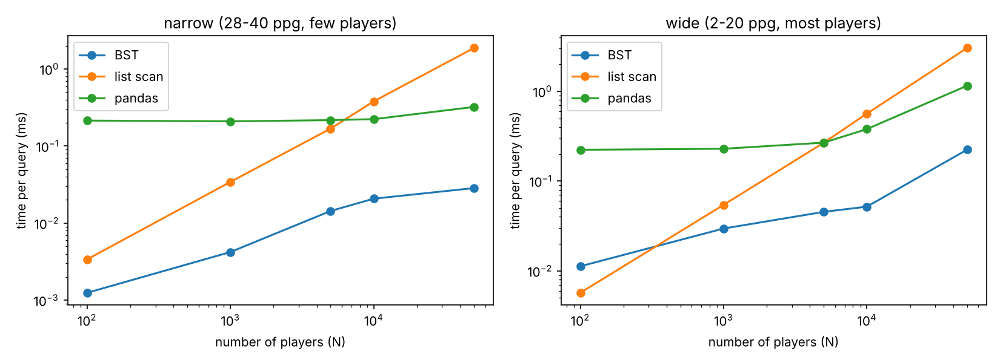

# Fantasy Basketball Draft Tool

Final project for CSE 20312 Data Structures (Notre Dame, Fall 2026).

A command-line tool for running a fantasy basketball draft on real NBA data.
It is built on data structures from the course instead of library shortcuts:
a binary search tree for stat-range filters, hash tables (Python dicts) for
player lookup, and a max-heap for the draft board.

## Status

| Part | State |
| --- | --- |
| Bootstrap: BST range query, tests, benchmark | Done |
| Real data and loader (1950 to 2026) | Done |
| Draft board (max-heap by fantasy score) | Next |
| Command-line app | Planned |
| Final Big-O write-up and video demo | Planned |

## What is in the repo

| Path | What it is |
| --- | --- |
| `bootstrap/player_bst.py` | Binary search tree that stores players by a stat and answers range queries |
| `bootstrap/player_bst_test.py` | Unit tests for the tree |
| `bootstrap/benchmark.py` | Times the tree against a list scan and pandas |
| `data/nba_seasons.csv` | 25,319 real player seasons, 1950 to 2026 (see `data/README.md`) |
| `loader.py` | Reads the data and builds the tree and the lookup dicts |
| `loader_test.py` | Unit tests for the loader |
| `functions.py`, `unit_test.py` | Simple functions with unit tests, requested by the professor |

## How to run it

Needs Python 3. The benchmark also needs `pandas` and `matplotlib`.

```
python3 loader.py                          # load 2025-26 and run sample queries
python3 -m unittest loader_test -v         # loader tests
cd bootstrap
python3 -m unittest player_bst_test -v     # tree tests
python3 benchmark.py                       # timing table and benchmark.png
```

## Bootstrap subproject

The bootstrap extends the binary search tree from Homework 8 in two ways:

1. A node keeps a list of players, so players with the same stat are all kept.
2. `range_query(lo, hi)` returns every player whose stat is between `lo` and `hi`.
   It skips any subtree that cannot contain a match, so it does not look at every player.

This is the main project's core question ("who is available between X and Y?"),
built by hand and measured before the rest of the tool depends on it.

### Benchmark

Time for one range query on generated players, from 100 to 50,000 of them:



At 50,000 players (milliseconds per query):

| Query | BST | List scan | pandas |
| --- | --- | --- | --- |
| Narrow range, 1,467 players returned | 0.03 | 1.87 | 0.32 |
| Wide range, 35,011 players returned | 0.22 | 3.03 | 1.15 |

The list scan checks every player, so it grows in step with N: O(N).
The tree visits only the nodes on the path to the range plus the nodes inside it.
Because stats have one decimal place, the tree never has more than a few hundred
nodes however many players are loaded, so its time grows very slowly.

## Data

Player season stats come from Basketball-Reference, by way of Sumitro Datta's
[bball-reference-datasets](https://github.com/sumitrodatta/bball-reference-datasets).
Details and cleaning steps are in `data/README.md`.

## Use of AI

I planned this project with the course's Gemini notebook and built it.
I wrote the first versions of the bootstrap code, the loader, and the tests,
found and cleaned the dataset with the help of AI to clean the dataset.
